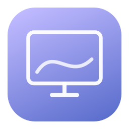

<p align="center">
  
</p>

# LumaDisplay

Control your Mac's displays from a native dashboard or the menu bar. Adjust resolution, brightness and warmth, save your workspace as a preset, and use extra HDR brightness on compatible displays.

[Download the preview](https://github.com/yuazi/LumaDisplay/releases/tag/v1.1.0) · [Report an issue](https://github.com/yuazi/LumaDisplay/issues) · [Contribute](CONTRIBUTING.md)

## Features

- Connected-display discovery with resolution, refresh rate, pixel dimensions and HiDPI information.
- Resolution and refresh-rate selection from the modes macOS provides. Changes have a 15-second preview and automatic rollback.
- Hardware brightness on supported displays, plus software dimming down to 20%.
- Adjustable warmth for each display.
- Unified brightness control up to 200%, with HDR overlay or experimental Direct XDR upscaling on supported built-in displays.
- Local presets for resolution, brightness, dimming and warmth across connected displays.
- Menu-bar controls, display identification, and a shortcut to macOS Display Settings.

Upscaling starts off. If a previous direct session was interrupted, the app restores its saved settings on launch. It has no analytics, network access, account requirement or background service.

## Install

The [v1.1.0 preview](https://github.com/yuazi/LumaDisplay/releases/tag/v1.1.0) includes an Apple silicon build for macOS 13 or later. Download the ZIP, extract it, and move `LumaDisplay.app` to Applications.

The download is ad-hoc signed and has not been notarized by Apple. If macOS blocks it, you can build the app from source using the steps below. Intel builds are not included in this release; the source targets the build machine's architecture, but Intel hardware has not been tested.

Closing the dashboard leaves LumaDisplay in the menu bar. Choose **Quit** to exit and remove its visual effects.

## Build from source

Install Xcode or Apple's Command Line Tools with Swift 5.9 or later, then run:

```sh
git clone https://github.com/yuazi/LumaDisplay.git
cd LumaDisplay
./Scripts/build-app.sh
open dist/LumaDisplay.app
```

You can also open `Package.swift` in Xcode. The project has no external Swift package dependencies. The build script compiles the app, generates its icon, includes the license notices, and signs the local bundle.

## Brightness upscaling

Choose **HDR overlay** or **Direct XDR** under Brightness upscaling. Move the main brightness slider above 100%, or enable upscaling and adjust its level. Switching methods stops and restores the previous method first.

**HDR overlay** uses Metal to amplify desktop content within the current extended dynamic range (EDR). It sets supported hardware brightness to its normal maximum while active and adapts software gain to the available headroom. The previous hardware brightness restores when disabled, unless brightness was adjusted externally.

**Direct XDR** controls the built-in display's brightness properties without amplifying the whole desktop through an overlay. It is available only when the physical Apple display exposes the required properties and system APIs. It temporarily selects the XDR preset and pauses automatic brightness. Requested luminance is bounded by the original physical ceiling and twice the normal brightness cap. A recovery record is saved before changes; disabling, sleeping, quitting, or restarting after an interruption restores the original settings. Only one app instance can own this mode.

Both methods start off and stop when the app quits or the Mac or display sleeps. Presets do not enable them. External HDR monitors must already have HDR enabled in macOS Display Settings; an SDR-only monitor cannot gain HDR capability through the app. Brightness-key changes stop direct mode instead of repeatedly overriding the system adjustment.

The overlay follows other apps into full-screen Spaces. Version 1.0.1 fixes an issue where Netflix in Comet lost the boost on entering full screen and regained it on exit. Protected video and hardware-specific playback paths may still behave differently; keeping an overlay visible does not guarantee every video surface can be amplified.

Overlay percentages describe software gain; direct percentages describe a requested driver target. Neither measures physical nits. Upscaling can affect HDR highlights and increase power use. Turn it off for color-critical work and accurate HDR viewing. Both methods are experimental; the display and macOS determine the available output.

## Presets and recovery

Presets are stored in `~/Library/Application Support/LumaDisplay/presets.json` and match displays by stable UUID. Applying a preset reports missing displays or unavailable modes before making changes. When a preset changes resolution, brightness and warmth apply after you choose **Keep changes**.

Unconfirmed display modes are scoped to the app, so macOS restores session settings when the process exits. The rollback timer runs during menu interactions. A failed rollback retains its original settings and offers a retry. Confirmed modes last for the current login session.

Use **Displays → Reset HDR, Dimming & Warmth** or **⌘⇧0** to stop upscaling and remove visual effects. A failed direct restoration retains its recovery record and prevents a normal quit until restoration succeeds. Retry Reset all effects if the display is temporarily unavailable.

## Compatibility and limits

The app has been tested on an Apple M1 Pro Mac with a built-in Retina display. Desktop brightening was visually confirmed on that panel. Physical luminance has not been measured. External monitors, multiple-display hot-plug, and the full range of supported macOS versions still need testing.

Hardware brightness uses an optional private DisplayServices API whose availability can change with macOS. Software dimming and warmth use overlays, which can behave differently on secure system surfaces, in full-screen apps, or alongside other display utilities.

Direct mode learns the normal brightness range for each display preset and keeps it across launches, since HDR content temporarily changes live backlight values. After restoration, macOS continues managing those live readings; the requested display preset, automatic brightness, hardware brightness and physical caps are restored.

This release does not implement DDC/CI, virtual displays, custom modes, EDID overrides, display arrangement, rotation, mirroring controls, streaming or picture-in-picture. Use macOS Display Settings for mirrored-display mode changes.

## Development checks

```sh
swift test
dist/LumaDisplay.app/Contents/MacOS/LumaDisplay --diagnose
dist/LumaDisplay.app/Contents/MacOS/LumaDisplay --diagnose-hdr
```

Both diagnostic commands report display information and exit; pending direct recovery is performed at startup. The fourteen tests cover display-mode rollback, HDR limits, direct brightness units, partial-write recovery, checkpoint failures and preset persistence. XCTest requires a full Xcode installation on systems whose Command Line Tools do not include it. You can select an installed Xcode for a single invocation with `DEVELOPER_DIR`.

For a rendering smoke test, `--verify-hdr` briefly applies 110% gain for three seconds, reports completed Metal frames, then disables boost and exits. It changes the display during the test.

For direct mode, `--verify-direct --verify-hdr-seconds 6` briefly requests 110%, reports driver readback, restores its snapshot, and exits. `--diagnose-hdr` also reports the preset, automatic brightness, driver properties and recovery status. These tests change display settings and should run with other brightness-control apps disabled.

To check full-screen transitions, first disable HDR in any other running LumaDisplay instance, then run:

```sh
dist/LumaDisplay.app/Contents/MacOS/LumaDisplay --verify-hdr --verify-hdr-seconds 60
```

Enter and exit full screen in the affected app. The test reports whether its overlay is on the active Space and visible, whether it takes focus, and whether Metal frames continue to complete. It automatically disables its boost and exits after the requested duration (3–60 seconds). These diagnostics do not measure luminance or inspect video pixels.

## License and credits

LumaDisplay is licensed under [GNU GPL version 3](LICENSE). Its HDR rendering technique is adapted from [BrightIntosh](https://github.com/niklasr22/BrightIntosh) by Niklas Rousset and contributors. See [third-party notices](THIRD_PARTY_NOTICES.md) for attribution and source references.
